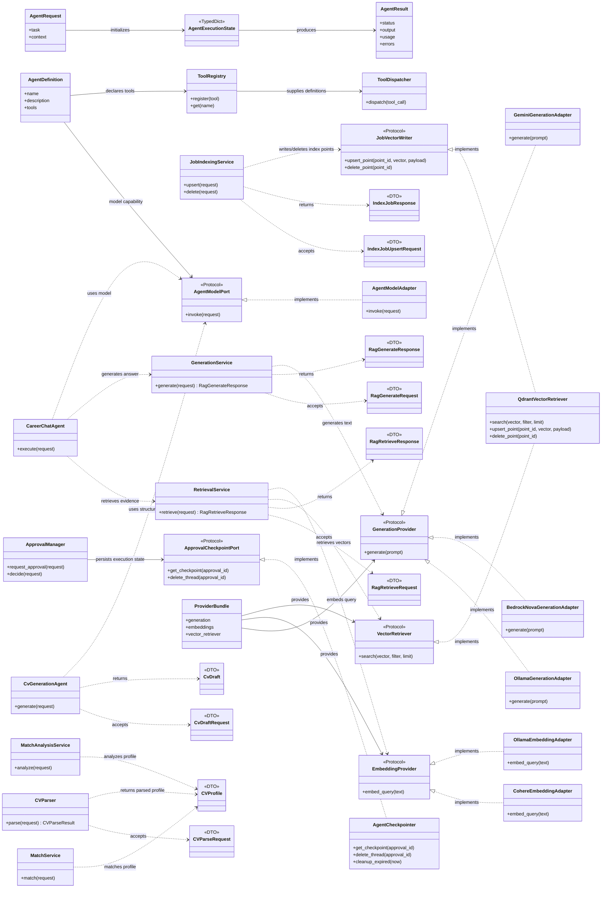

# AI Service Class Diagram

Sơ đồ lớp tập trung vào các thành phần chính của FastAPI: API/service theo
module, hợp đồng agent, và adapter hạ tầng. Schema request/response Pydantic
được thể hiện như DTO, không phải entity lưu trữ.

Lớp có `<<Protocol>>` là boundary/interface; adapter cụ thể được chọn qua
`ProviderBundle`/provider factory theo cấu hình. `AgentCheckpointer` lưu state
checkpoint trong schema PostgreSQL riêng; các DTO trong sơ đồ là hợp đồng
truyền dữ liệu, không phải các bản ghi database.
