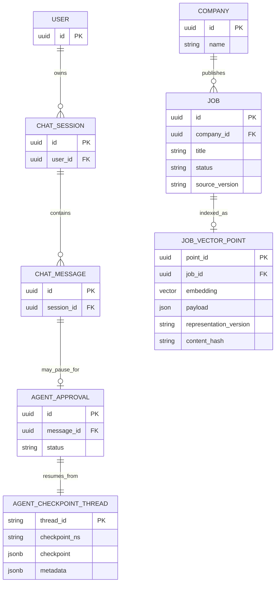

# AI Service ERD

Sơ đồ thể hiện dữ liệu mà AI service đọc, xử lý và lưu trữ. NestJS/PostgreSQL
vẫn là nguồn dữ liệu chuẩn cho nghiệp vụ; Qdrant là chỉ mục dẫn xuất. Các
snapshot trong request chỉ tồn tại trong thời gian xử lý, trừ checkpoint agent.

## Ownership and persistence

- `USER`, `CHAT_SESSION`, `CHAT_MESSAGE`, `AGENT_APPROVAL`, `COMPANY` và `JOB`
  là thực thể nghiệp vụ thuộc NestJS/PostgreSQL. AI service nhận định danh và
  context đã được backend xác thực; không phải chủ sở hữu các bảng này.
- `JOB_VECTOR_POINT` là bản ghi khái niệm trong collection Qdrant, không phải
  bảng PostgreSQL. Payload giữ ID job chuẩn, thông tin lọc cần thiết và metadata
  phiên bản biểu diễn; vector có thể được dựng lại từ job chuẩn.
- `AGENT_CHECKPOINT_THREAD` đại diện cho thread trong schema PostgreSQL
  `agent_checkpoint` do LangGraph checkpointer quản lý. `thread_id` được đặt
  bằng ID approval; checkpoint giữ state để tiếp tục execution. Các bảng
  checkpoint thực tế được LangGraph tạo và quản lý.
- `AGENT_APPROVAL` được vẽ để diễn tả quan hệ nghiệp vụ với checkpoint; nó thuộc
  backend, không phải bảng do AI service tạo.
- Snapshot CV, context job, kết quả retrieval/matching và nội dung generation
  là dữ liệu request/response tạm thời; sơ đồ không xem chúng là bản ghi lưu
  bền vững của AI service.

Quan hệ giữa dữ liệu của NestJS và AI service qua API dùng ID tham chiếu; không
có foreign key PostgreSQL xuyên qua ranh giới service. Quan hệ `JOB` →
`JOB_VECTOR_POINT` là ánh xạ theo `job_id`, được đồng bộ bởi pipeline indexing.
