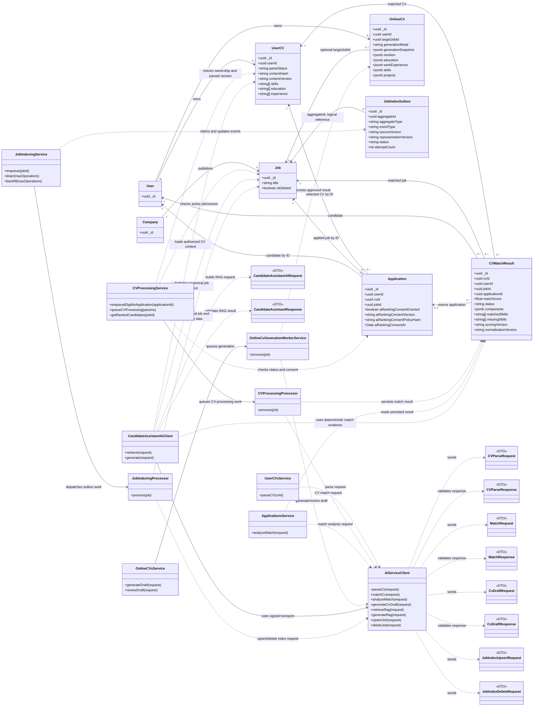

# Backend Classes Integrated With AI Service

Class diagram for backend-owned entities and application classes that call or
prepare work for the FastAPI AI service. It focuses on CV parsing/matching,
generated CV drafts, candidate-assistant RAG, and job indexing.

`User`, `Company`, `Job`, `Application`, `UserCV`, `CVMatchResult`, `OnlineCV`
and `JobIndexOutbox` are backend domain/persistence classes. The request/response
classes are integration DTOs, not database entities. AI calls cross the
`AiServiceClient` HTTP boundary; FastAPI does not directly own the backend rows.

The links labelled “by ID” or “logical reference” are correlation/identity
relationships in backend logic. They are not all declared TypeORM foreign keys;
in particular, `JobIndexOutbox.aggregateId` references a job without a database
foreign-key relation. Candidate-assistant conversations/history are owned by
the backend product flow and are not depicted as AI-service persistence.
