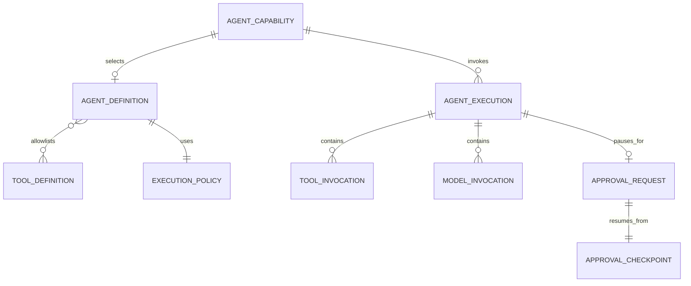
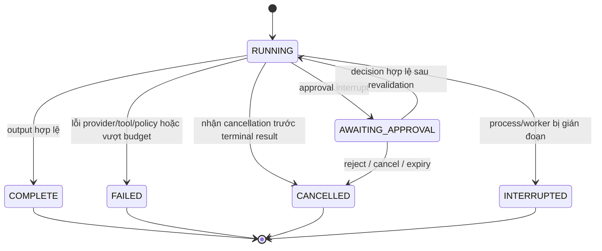

# Mô hình dữ liệu logic

## Phạm vi lưu trữ

Các thực thể dưới đây mô tả hợp đồng runtime và logical state. Execution thường chỉ ở memory, không checkpoint. Ngoại lệ là approval graph đang chờ quyết định; graph này lưu checkpoint tối thiểu ở checkpointer riêng để resume cùng execution sau restart. Chat session/history và CV operation/queue tiếp tục do NestJS sở hữu. Checkpointer không lưu business data và không truy cập bảng nghiệp vụ.

## Thực thể

### AgentCapability

Định danh một loại năng lực AI có thể chọn implementation legacy hoặc agent.

| Thuộc tính | Ý nghĩa | Ràng buộc |
|---|---|---|
| `capability_id` | Tên ổn định của capability | Duy nhất trong registry; không lấy trực tiếp từ nội dung model |
| `implementation` | `legacy` hoặc `agent` | Lựa chọn server-side theo capability; mặc định `legacy` |
| `agent_definition` | Tham chiếu định nghĩa agent khi bật agent implementation | Không chứa state của từng lần chạy |
| `input_contract` | Hợp đồng riêng của capability | Kiểm tra trước khi gọi model/tool |
| `output_contract` | Hợp đồng kết quả riêng của capability | Kiểm tra trước khi trả về adapter hiện có |

### AgentDefinition

Cấu hình tĩnh của một agent, được sở hữu bởi capability tương ứng.

| Thuộc tính | Ý nghĩa | Ràng buộc |
|---|---|---|
| `system_instructions` | Chỉ dẫn nghiệp vụ | Riêng theo agent; không ghi vào execution logs |
| `model_profile` | Chọn cấu hình model dùng qua provider boundary chung | Không chứa credential; không buộc mọi agent dùng cùng model |
| `tool_allowlist` | Tập tool ID được capability cho phép | Allowlist rõ ràng; model không thể thêm tool |
| `execution_policy` | Giới hạn bước, lượt model/tool, thời gian và retry | Được chọn từ cấu hình đáng tin cậy, không do model/client tự tăng |
| `validator` | Quy tắc domain kiểm tra kết quả | Thuộc capability, tái sử dụng validator hiện có |
| `graph_schema_version` | Phiên bản state schema của StateGraph | Pending approval checkpoint phải được resume bởi graph tương thích phiên bản đó |
| `checkpoint_mode` | `none` hoặc `approval_only` | Mặc định `none`; chỉ approval workflow chọn `approval_only` |

### AgentExecution

Một lần thực thi request-scoped. Đây là state tạm trong runtime, không phải bản ghi bền vững.

| Thuộc tính | Ý nghĩa | Ràng buộc |
|---|---|---|
| `run_id` | ID tương quan duy nhất của execution | Sinh bởi host; không dùng để cấp quyền |
| `capability_id` | Capability đang chạy | Phải có trong registry |
| `correlation_id` | Liên kết với request/operation hiện hữu | Không thay `session_id`, CV operation ID hoặc idempotency key nghiệp vụ |
| `status` | `RUNNING`, `AWAITING_APPROVAL`, `COMPLETE`, `FAILED`, `CANCELLED`, `INTERRUPTED` | Chỉ approval graph được vào `AWAITING_APPROVAL`; terminal state không quay lại `RUNNING` |
| `step_count`, `model_call_count`, `tool_call_count` | Mức tiêu thụ budget | Không vượt `execution_policy` |
| `started_at`, `finished_at` | Thời gian vận hành | Dùng cho metrics/tracing; không mang PII |
| `output` | Kết quả nội bộ có kiểu của capability | Chỉ giữ trong thời gian cần để hoàn tất request |
| `error` | Lỗi nội bộ đã phân loại và làm sạch | Client chỉ nhận mã/thông báo an toàn |

Execution thường không được lưu vào PostgreSQL, Valkey hoặc checkpointer. Khi process dừng, state mất; retry là execution mới. Approval graph đang chờ decision là ngoại lệ và sử dụng `ApprovalCheckpoint` tối thiểu bên dưới.

`CANCELLED` là trạng thái thực thi được yêu cầu/quan sát ở runtime, không bảo đảm hủy được inference đã gửi tới provider. Kết quả đến muộn phải bị bỏ qua và không được bắt đầu tool/model step tiếp theo; NestJS version/terminal fences tiếp tục là nguồn chặn persistence cuối cùng.

### ApprovalRequest và ApprovalCheckpoint

Approval workflow chỉ được dùng trước publish/material write, không dùng cho việc persist draft `EDITOR_ONLY` sau user-triggered generate hiện tại.

| Thuộc tính | Ý nghĩa | Ràng buộc |
|---|---|---|
| `approval_id` | Opaque ID đồng thời làm LangGraph `thread_id` | Sinh ở server; không phải credential; quyết định chỉ tới từ trusted NestJS caller |
| `operation_ref` | CV operation/business action cần approve | Stable reference; không chứa CV prose |
| `resource_ref`, `expected_version` | Tài nguyên và version cần được xác nhận | Resume phải revalidate quyền, consent và version qua owner service |
| `action_code` | Publish/material action đang chờ | Enum allowlisted; không lấy code tùy ý từ model |
| `status` | `PENDING`, `APPROVED`, `REJECTED`, `EXPIRED` | Chỉ một quyết định cuối được chấp nhận; xử lý idempotent |
| `graph_schema_version` | Graph/state version lúc interrupt | Pending thread phải được resume bởi compatible graph; không xóa node/key trước khi drain/expire |
| `expires_at` | Timestamp UTC, 24 giờ sau khi approval được tạo | Decision sau thời điểm này bị từ chối; cleanup xóa checkpointer thread |

`ApprovalCheckpoint` là snapshot của approval graph trong checkpoint tables do PostgresSaver quản lý ở PostgreSQL hiện có. DB principal của AI service chỉ được quyền với các checkpoint tables, không được truy cập business tables. Graph này chỉ chứa approval/reference/version/action metadata: không có CV text, prompt, messages, raw model/tool output hoặc secret. Xóa thread sau approve/reject/cancel/expiry; business approval audit vẫn ở NestJS.

### ToolDefinition và ToolInvocation

`ToolDefinition` là định nghĩa tái sử dụng; quyền sử dụng được cấp theo `AgentDefinition.tool_allowlist`.

| ToolDefinition field | Ý nghĩa | Ràng buộc |
|---|---|---|
| `tool_id` | Tên ổn định của thao tác | Duy nhất trong catalog |
| `input_contract` / `output_contract` | Schema input/output | Input được validate trước handler; output được validate trước khi trả vào model context |
| `required_operation` | Thao tác/phạm vi quyền cần thiết | Kiểm tra bởi application boundary, không phải LLM |
| `timeout` | Thời hạn riêng của lần gọi tool | Bị chặn thêm bởi execution deadline chung |
| `side_effect_class` | Phân biệt đọc và ghi | Không cung cấp generic database/write tool; ghi CV thực hiện qua luồng nghiệp vụ hiện hữu |

`ToolInvocation` có `tool_call_id`, `tool_id`, trạng thái, thời lượng và error code. Input/output nhạy cảm không được lưu vào telemetry. Input sai schema, tool ngoài allowlist hoặc thiếu quyền bị từ chối trước handler, không tạo side effect.

### ModelInvocation

Một lần gọi model trong execution, gồm `invocation_id`, `model_profile`, thời lượng, trạng thái, token/call usage nếu provider trả về và error category. Nội dung prompt, CV và output nguyên văn không thuộc telemetry. Chính sách retry/repair cụ thể vẫn thuộc capability; runner chỉ áp dụng budget chung và không tự chạy legacy thay thế.

### ToolExecutionContext

Context runtime được tạo từ request đã qua kiểm tra ở application service: `run_id`, `capability_id`, correlation ID, principal/resource references đã được cấp quyền, tool allowlist, deadline, bộ đếm budget và cancellation signal nếu caller có thể truyền. Context không chứa credential thô, và model không được sửa context này.

## Quan hệ

Các entity `AGENT_EXECUTION`, `TOOL_INVOCATION`, và `MODEL_INVOCATION` chỉ tồn tại trong memory của run. Chỉ approval checkpoint tương ứng các graph đang thực sự chờ người duyệt được lưu bền vững; đây là checkpoint store, không phải bảng business entity.

## Lifecycle

Execution thường bị interrupt bởi process restart sẽ kết thúc `INTERRUPTED`; retry tạo run mới. Riêng `AWAITING_APPROVAL` được checkpoint và resume cùng `thread_id`. `DEGRADED` là trạng thái nghiệp vụ bên trong kết quả chatbot/CV hiện tại, không phải execution persistence state mới. Adapter giữ nguyên cách ánh xạ response/status hiện hữu.
