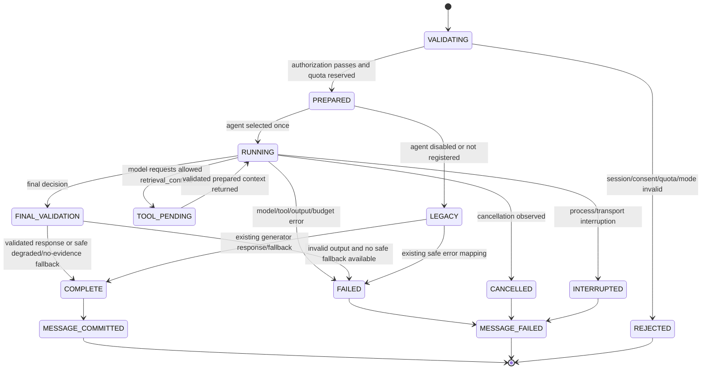

# Mô hình dữ liệu và state: Career Chat Agent

## Ranh giới lưu trữ

Không thêm business entity, execution store hay conversation persistence riêng. Session/messages/quota tiếp tục do application chatbot sở hữu. Agent execution thường chỉ tồn tại trong memory cho một request; lease metadata được lưu cùng persistence request/quota hiện có, hoặc qua migration tối thiểu tương thích ngược nếu cần. Retrieval index hiện có tiếp tục chứa dữ liệu dẫn xuất của job công khai; PostgreSQL canonical data không được agent truy cập trực tiếp.

## Thực thể và hợp đồng logic

### ChatSession

Nguồn sự thật là session hiện hữu trong ứng dụng.

| Field logic | Ý nghĩa | Quy tắc |
|---|---|---|
| `session_id`, `user_id` | Định danh phiên và chủ sở hữu | Ownership kiểm tra trước agent execution |
| `mode` | `JOB_SEARCH`, `ADVICE`, `CV_ANALYSIS`, `CV_JOB_COMPARISON` | Không đổi trong migration; invariant CV theo mode được giữ |
| `archived_at` | Trạng thái archive | Archived session không nhận message mới |
| `updated_at` | Activity gần nhất | Chỉ cập nhật theo hành vi ứng dụng hiện tại |

### ChatMessage

Lưu bởi ứng dụng như hiện nay; không thay schema.

| Field logic | Ý nghĩa | Quy tắc |
|---|---|---|
| `role`, `parent_message_id` | USER/ASSISTANT và liên kết lượt | Giữ threading hiện tại |
| `client_message_id` | Idempotency key của user turn | Duplicate không tạo thêm message/quota |
| `status`, `content`, `blocks` | Trạng thái và nội dung hiển thị | Giữ PROCESSING/COMPLETED/FAILED và shape hiện tại; cancellation/timeout làm assistant message FAILED và late result không được ghi đè trạng thái cuối |
| `citations`, `filter_state` | Evidence references và filter response | Chỉ chứa data đã validate/bound |
| `generation_metadata` | source/fallback reason | Không ghi prompt/model payload |

Client disconnect/timeout hoặc process interruption được phát hiện sau khi nhận user turn giữ user message COMPLETED, đánh assistant message FAILED và release quota reservation đúng một lần. Recovery dùng lease bền vững có owner/expiry gắn với execution/request; execution gia hạn mỗi 10 giây, TTL 30 giây cộng grace 5 giây, reconciler định kỳ chạy mỗi 15 giây và phải terminalize orphan trong 50 giây từ lần gia hạn cuối khi runtime/database khỏe. Reconciler chỉ xử lý lease hết hạn bằng cập nhật nguyên tử có điều kiện, không đánh nhầm execution còn sống ở instance khác. Không thêm trạng thái CANCELLED vào message schema; execution có thể CANCELLED/INTERRUPTED nhưng assistant message app-level là FAILED. Interrupted execution không tự resume/replay. Abort upstream là best-effort; completion muộn luôn bị bỏ trước khi lưu assistant response hoặc commit quota.

### AssistantRequestContext

Context request-scoped được NestJS chuẩn bị sau auth/consent/quota. Không persist vào Foundation.

| Field logic | Owner/nguồn | Ràng buộc |
|---|---|---|
| Current message, mode, locale | Chat request | Đã validate giới hạn hiện tại |
| `recent_history` | Chat messages | Tối đa 8 entries, tổng tối đa 6000 ký tự; chỉ nạp sau mode/consent/CV snapshot guard; không lấy history từ session CV khác |
| Filters | Request + session state | Structured fields/range được validate; không coi model inference là filter đã xác nhận |
| Canonical jobs | Application service | Chỉ active/allowed context; tối đa 8 job facts trong generation request |
| Retrieval evidence | Existing retrieval response | Tối đa 20 result; ID phải khớp canonical context trước grounding |
| Authorized CV snapshot | User CV service | Chỉ CV mode, đúng owner, consent/version hợp lệ; giới hạn/sanitized text theo schema |
| Matching evidence | Deterministic matcher | Chỉ CV_JOB_COMPARISON; CV/job IDs phải khớp request |
| Request/trace/client IDs | Application service | Correlation; không dùng làm authorization credential |

### AgentDefinition

Định nghĩa tĩnh capability `rag.generate`; tái sử dụng Foundation type.

| Field | Giá trị logic | Ràng buộc |
|---|---|---|
| `capability_id` | `rag.generate` | Đăng ký server-side; không lấy từ client/model |
| `output_model` | `ProviderGeneration` | Strict validation; adapter/domain validator cuối trả `RagGenerateResponse` |
| `model_profile` | Profile của provider đang compose | Metadata hiện tại; không tự đổi provider |
| `tool_allowlist` | `rag.retrieve_context`, `career.read_matching_evidence` | Hai read-only tools; matching chỉ trong comparison intent |
| `execution_policy` | Step/model/tool/deadline limits | Giá trị hữu hạn, nằm trong service request deadline; đo trước rollout |

### AgentExecution

Một lần chạy Foundation cho một `RagGenerateRequest`.

| Field | Ý nghĩa | Quy tắc |
|---|---|---|
| `run_id`, `correlation_id` | Execution/trace IDs | Sinh ở server; không là quyền truy cập |
| `capability_id` | `rag.generate` | Phải khớp AgentDefinition đã đăng ký |
| `status` | COMPLETE/FAILED/CANCELLED/INTERRUPTED | Không thay `answer_status` hay ChatMessage.status |
| `step_count`, `model_call_count`, `tool_call_count` | Budget đã sử dụng | Dừng trước khi gọi tiếp nếu cạn |
| `output`, `error` | Kết quả/controlled error | Chỉ trả output qua RAG adapter sau contextual validation |
| `lease_owner`, `lease_expires_at` | Quyền sở hữu execution đang chạy và hạn lease | Được gia hạn khi còn active; không lưu trong process-local state; reconciler định kỳ chỉ finalize sau expiry grace bằng cập nhật nguyên tử |

### RetrievalContextToolInvocation

Read-only access tới evidence đã chuẩn bị; tool không chạy query tùy ý và không đọc business store. Prompt ban đầu không embed current request's canonical job/CV/retrieval facts; bounded session history tiếp tục theo contract hiện tại. Facts từ request chỉ được cung cấp qua tool output sau khi authorization/context check.

| Field | Ý nghĩa | Quy tắc |
|---|---|---|
| `tool_call_id`, `tool_id` | Foundation tool invocation IDs | Tool IDs cố định `rag.retrieve_context` hoặc `career.read_matching_evidence` |
| Input | Empty/closed object | Không nhận arbitrary user/resource IDs |
| Output | Canonical job facts, paired retrieval evidence, filter state và CV snapshot nếu mode được phép | Chỉ subset của trusted request; không được mở rộng quyền/context; factual/CV modes yêu cầu tool thành công trước final |
| `required_operation` | `rag:generate` internal capability boundary | Route service-scope đã xác thực; per-request consent/ownership do application owner xác nhận |

`career.read_matching_evidence` dùng cùng execution entity, chỉ khác `tool_id` và chỉ hợp lệ khi intent là `CV_JOB_COMPARISON`; handler trả evidence đã tính, không chạy lại matcher.

## State transitions

Agent state không resume sau restart. Conversation history/session không phải `AgentExecutionState`; approval statuses/checkpointer không áp dụng. Legacy selection chỉ xảy ra ở đầu request. Sau RUNNING, lỗi không chuyển state sang LEGACY. Khi execution bị cancel/timeout, late completion không thể chuyển `MESSAGE_FAILED` sang `MESSAGE_COMMITTED`.

## Invariants

- CV snapshot chỉ hợp lệ với intent CV_ANALYSIS/CV_JOB_COMPARISON và consent/version phù hợp; non-CV intent không nhận CV.
- Retrieval evidence IDs phải là subset canonical context IDs. Citation key phải map tới đúng một job; job citation phải pair với referenced job IDs.
- CV_JOB_COMPARISON cần matching evidence xác định cho chính CV/job request; agent không được cập nhật score.
- Tool input/output được validate trước/sau handler; handler trả context từ request hiện tại, không nhận quyền từ text.
- Không đưa prompt, full conversation, CV text hoặc raw tool/model payload vào observation/logs.
- Tool timeout là cooperative ở Foundation hiện tại; handlers không được làm provider I/O. Mọi call I/O tương lai cần timeout enforcement riêng và test.
