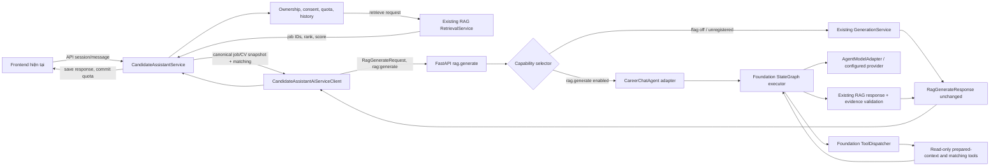
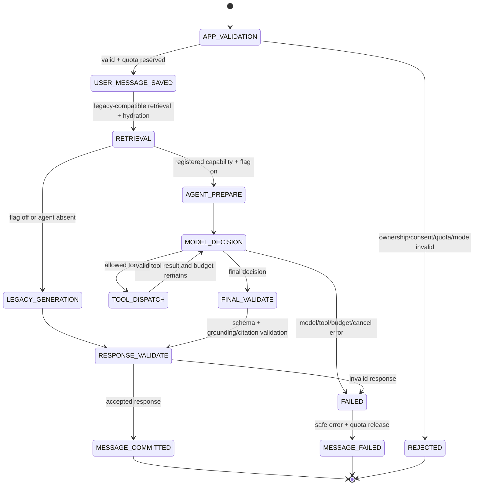

# Kế hoạch triển khai: Career Chat Agent

**Branch**: `002-career-chat-agent` | **Date**: 2026-11-17 | **Spec**: [spec.md](spec.md)

**Input**: Đặc tả tính năng `specs/002-career-chat-agent/spec.md`.

## Tóm tắt

Chuyển riêng capability sinh câu trả lời chatbot sang Agent Foundation theo rollout server-side, giữ API `/ai/candidate-assistant` và internal RAG request/response. Application service tiếp tục xác thực session/consent/quota, giới hạn history, hydrate canonical job/CV context và gọi retrieval như hiện tại. FastAPI RAG generation route chọn legacy `GenerationService` hoặc agent implementation cho `rag.generate`; agent dùng `StateGraph`, model/tool/error/budget/observability contracts hiện có. Agent đọc retrieved context qua read-only tool và dùng prompt, locale, validators, citations và fallback hiện có của RAG module. Thêm một adapter change hẹp để Bedrock agent calls có timeout thực; legacy provider/client giữ nguyên. Không thêm nguồn dữ liệu, conversation store hay checkpoint.

Migration tập trung vào một seam: nối selector/executor chưa được route sử dụng vào capability RAG generate. Không thay ownership của history/retrieval hydration và không để tool agent truy cập business database.

## Technical Context

**Language/Version**: Python >=3.12,<3.14 cho AI service; TypeScript/NestJS hiện hữu chỉ thay đổi nếu cần contract test hoặc selector wiring phía application, không thay đổi public controller/DTO.

**Primary Dependencies**: LangGraph `StateGraph` 1.2.22, Foundation `execute_agent`, `AgentModelAdapter`, `ToolDispatcher`, Pydantic 2; provider hiện tại qua `GenerationProvider`/`StructuredGenerationProvider`. Không thêm agent framework, model provider hoặc dependency.

**Storage**: PostgreSQL hiện hữu tiếp tục lưu chat session/message/quota thuộc application service. Qdrant tiếp tục là vector index job hiện có. Không thêm execution store hay checkpointer cho conversation/agent run. Ưu tiên đặt lease trong persistence request/quota hiện có; nếu không đủ trường để lưu lease bền vững, T033 phải thực hiện migration tối thiểu, compatibility tests và rollback trước rollout.

**Testing**: pytest/Ruff/mypy cho AI service; Jest cho candidate-assistant và NestJS-to-FastAPI loopback contract. Dùng synthetic CV/job, fake providers, in-memory retrieval; không cần LLM thật. PostgreSQL Foundation approval tests không thuộc đường chạy của Career Chat.

**Target Platform**: Linux service runtime hiện có; AI service FastAPI và application NestJS.

**Project Type**: Tích hợp capability trên multi-service web application hiện hữu.

**Performance Goals**: Không đặt latency/availability/scale SLO sản phẩm mới; giữ operational baseline hiện hành. Không tăng số lượt gọi model không cần thiết; đo latency/cost trên các luồng hiện hành trước rollout và so sánh legacy/agent bằng correlation IDs. Agent tối đa 24 giây và transport timeout tối thiểu 29 giây là release gates để dừng an toàn trước transport deadline, không phải latency SLO sản phẩm.

**Constraints**: Không đổi public/internal chatbot schemas nếu không có contract versioning cần thiết; chỉ xử lý authorized snapshot/context; tool chỉ đọc dữ liệu đã được cung cấp hoặc qua owner boundary; không log prompt/history/CV; legacy mặc định; lỗi agent không retry qua legacy cùng request. Existing AI transport có timeout 30s ở production mặc định và 180s local/test; Foundation default execution policy là 30s. Production Bedrock adapter không nhận timeout từ `AgentModelAdapter` hiện tại nên agent không thể bật trước khi timeout-aware adapter có test.

**Scale/Scope**: Một developer triển khai tuần tự một capability `rag.generate`, gồm 4 mode hiện tại (`JOB_SEARCH`, `ADVICE`, `CV_ANALYSIS`, `CV_JOB_COMPARISON`). Không triển khai Career Chat UX mới, CV Agent, business tool catalog tổng quát hoặc multi-agent flow.

## Constitution Check

**Trước Phase 0**

- **Brownfield-first**: Đạt. Dùng CandidateAssistantService/client, history/consent/quota, RAG retrieve/generate, prompt builder, citation validators, provider factory và Foundation hiện tại. Không thay chatbot.
- **Backward compatibility**: Đạt có điều kiện. Route/DTOs vẫn nguyên; `rag.generate` legacy mặc định. Bắt buộc loopback/OpenAPI regression trước rollout.
- **Least-privilege agent safety**: Đạt có điều kiện. Tool allowlist duy nhất theo capability, schemas đóng, authorization ở app boundary, budget hữu hạn; không có generic DB/HTTP/shell tool. Provider thiếu timeout-aware contract phải fail-closed.
- **CV privacy**: Đạt có điều kiện. Chỉ dùng snapshot NestJS đã cấp quyền/consented; application boundary không chuyển history có thể chứa CV-derived content khi consent hiện hành không hợp lệ hoặc mode không cho phép CV. Không đưa history/CV vào logs hoặc checkpoint.
- **Human approval**: Đạt. Agent chỉ trả lời; không ghi CV/job/session state ngoài hành vi lưu message hiện có. Không cần approval graph.
- **Testing**: Đạt có điều kiện. Deterministic provider/tool tests, AI contract tests và loopback Jest regressions là release gate.
- **Rollback**: Đạt có điều kiện. Feature flag capability off by default; rollback ảnh hưởng request tiếp theo; request đang chạy không đổi implementation.

Không có gate violation cần exception. Tất cả điều kiện trên phải được chứng minh trong task implementation trước khi bật capability.

## Phân tích luồng hiện hành

1. Frontend gọi Candidate Assistant API hiện có; không gọi AI service trực tiếp.
2. `CandidateAssistantService` kiểm tra role/session ownership/archive/consent, reserve quota, lưu user message idempotent, kiểm tra mode/job/CV constraints, lấy authorized CV snapshot, lấy tối đa 12 tin gần nhất rồi chuẩn hóa history còn tối đa 8 entries/6000 ký tự. CV-session requests chỉ tới bước chuẩn bị history sau khi CV snapshot/current consent được xác thực; mode không nhận CV thì không nhận CV context hoặc history từ session CV khác.
3. `CandidateAssistantAiServiceClient.generate()` gọi FastAPI `/internal/v1/rag/retrieve` với query/history/filter và public-active-jobs policy.
4. NestJS chọn canonical job context từ retrieved IDs và dữ liệu job được application service cấp; với CV_JOB_COMPARISON gọi matching xác định hiện có.
5. NestJS gọi `/internal/v1/rag/generate` với intent, history, CV snapshot/consent, canonical jobs, retrieval/matching evidence và identity.
6. `GenerationService` dựng prompt theo mode/locale, gọi provider, parse/validate claims/citations, kiểm tra grounding, có một repair attempt khi thích hợp và deterministic fallback.
7. NestJS validate/bound response, lưu assistant message, commit quota; lỗi/cancellation đánh dấu assistant message failed và release reservation. Kết quả model/tool đến sau khi request đã kết thúc không được persist hoặc commit quota.

Điểm nối agent là bước 6 tại FastAPI `rag.generate`; không đổi retrieval/canonical hydration giữa các bước 3-5 trong lần migration đầu.

## Sơ đồ kiến trúc và execution

Sơ đồ thành phần độc lập: [architecture.html](architecture.html); source có thể tái tạo: [career-chat-architecture.architecture.json](career-chat-architecture.architecture.json). Sơ đồ workflow chi tiết nằm dưới đây.



### Lifecycle và trạng thái

Conversation state không chuyển sang agent. Session/messages/quota tiếp tục do application service sở hữu; mỗi message tạo một request-scoped agent run mới. Context gồm message hiện tại, mode/locale, history tối đa 8 entries/6000 ký tự sau mode/consent guards, structured filters, canonical job context, retrieval evidence và authorized CV snapshot khi được phép. Khi cancellation/timeout kết thúc request, FAILED là trạng thái cuối của lượt; quota được release và late result bị bỏ.



Execution không có persisted agent state. `FAILED`, `CANCELLED` hoặc transport interruption không được tự retry bằng legacy trong cùng request; retry mới qua API tuân theo idempotency hiện có. Legacy fallback có sẵn bên trong RAG generation (ví dụ no-evidence/deterministic response) vẫn là behavior capability, không phải chạy lại implementation legacy.

## Quyết định thiết kế và giới hạn

- Dùng trực tiếp `StateGraph` builder/executor của Foundation; không thêm graph framework hoặc tự viết tool loop.
- Reuse mode/locale instructions và schemas từ RAG prompt/generation module. Prompt ban đầu có user turn, locale, mode, bounded authorized history và tool catalog render từ registered definitions; current request's canonical job/CV/retrieval facts chỉ được đưa vào context sau read-tool dispatch. Tool output được đánh dấu untrusted theo Foundation. Capability tạo prompt vì `execute_agent` nhận `AgentRequest.prompt` và không tự render prompt; không dựa vào `AgentDefinition.system_instructions` để tự ghép instructions nếu executor không consume field đó. Dùng bounded agent-specific Bedrock adapter/client cho agent branch; giữ nguyên timeout semantics legacy.
- Reuse `RagGenerateRequest` và `RagGenerateResponse` tại adapter boundary. Agent output phải được validate theo schema và chạy qua contextual grounding/citation validation của RAG module trước khi trả NestJS.
- **Retrieval boundary limitation:** vector retrieval hiện chạy trước generation ở NestJS→FastAPI rồi Nest hydrate canonical job context. Foundation tool handler chạy trong FastAPI, không có callback/tool protocol sẵn để gọi ngược NestJS nhằm hydrate job sau retrieval. Để giữ owner boundaries và tránh API mới, `rag.retrieve_context` chỉ expose evidence/context đã chuẩn bị sẵn cho agent; semantic vector retrieval tiếp tục ở host flow hiện hữu. Nếu yêu cầu rollout bắt buộc model tự kích hoạt truy vấn Qdrant trong graph, cần một contract retrieval/hydration hai giai đoạn được phê duyệt; không tự thêm endpoint/callback trong implementation mặc định.
- **History privacy:** history có tối đa 8 entries/6000 ký tự và được chuẩn bị ở application boundary sau khi mode/consent/CV snapshot validation hoàn tất. Session hiện lưu một mode cố định; mode không nhận CV không lấy history từ session CV khác, còn CV-mode request không gọi AI nếu snapshot/current consent không hợp lệ. Vì vậy không cần classifier CV-derived, per-message provenance field, xóa persisted history hay schema migration.
- Foundation `ToolExecutionContext.timeout_seconds` truyền deadline cho handler nhưng dispatcher không cưỡng chế dừng handler đồng bộ. Hai tool chỉ đọc prepared context trong memory, không gọi provider. `AgentModelAdapter` hiện bỏ timeout với provider chỉ có `generate(prompt)`; Bedrock production thuộc trường hợp này. Thêm method/client timeout-aware riêng cho agent và fail-closed nếu không hỗ trợ; không đổi legacy client. Capability cap tối đa 8 graph steps/4 model decisions/2 tool calls/24s; grounding reviewer phải nhận remaining deadline. Rollout gate yêu cầu internal HTTP timeout >=29s. Test chứng minh request dừng trước NestJS transport deadline.
- **Cancellation/recovery semantics:** HTTP client disconnect, request timeout và process interruption đã được phát hiện là cancellation triggers. Request đang chạy gia hạn lease bền vững gắn với request, owner và expiry mỗi 10 giây; lease có TTL 30 giây, grace 5 giây và reconciler chạy mỗi 15 giây. Trong điều kiện database/runtime khỏe, request mồ côi phải terminalize trong tối đa 50 giây từ lần gia hạn cuối. Reconciler chỉ kết thúc lease quá grace bằng cập nhật nguyên tử có điều kiện để tránh đua với execution còn sống hoặc reconciler khác, đồng thời tránh quota release hai lần. Ưu tiên persistence request/quota hiện hữu; nếu không lưu được lease, thêm migration tối thiểu, compatibility tests và rollback trước rollout. Controller/service chuyển cancellation tới AI transport và cố abort outbound request khi hỗ trợ. User message giữ COMPLETED; assistant response FAILED, quota reservation release đúng một lần. Interrupted execution không tự resume/replay; late model/tool results luôn bị bỏ trước persistence/quota commit. Không cam kết provider dừng inference đã bắt đầu; không thêm trạng thái CANCELLED vào public contract và không retry qua legacy.
- `AgentUsage.model_calls` đếm decision calls qua model port; tool không được gọi LLM lồng bên trong để tránh bỏ sót usage/budget. Các call generation/review của legacy path tiếp tục theo telemetry cũ.
- Selector được tạo nhưng hiện registry rỗng và router chưa dùng nó. Composition phải đăng ký `rag.generate` có kiểm soát và gọi selector đúng một lần tại route/service; flag không đủ nếu thiếu registered implementation.
- Foundation `model_profile` là metadata trong definition, không tự lựa chọn provider/model trong executor hiện tại. Dùng provider đã compose, không thêm lựa chọn model riêng ở capability.

## File/module change plan

Đây là phạm vi dự kiến cho bước tasks/implementation, chưa sửa code trong lệnh lập plan.

```text
ai-service/src/talentpulse_ai/
├── main.py                                      # compose model adapter, registry, selector dependency
├── agent_foundation/model.py                    # focused timeout-aware dispatch/fail-closed
├── dependencies.py                              # cung cấp registered rag.generate selector
├── modules/rag_chatbot/
│   ├── router.py                                # chọn legacy/agent tại internal generate route
│   ├── agent.py                                 # capability definition, prompt/context, result adapter
│   ├── agent_tools.py                           # read-only prepared-context tool definitions/handlers
│   ├── service.py                               # unchanged retrieval ownership unless task proves necessary
│   └── generation/
│       ├── generator.py                         # reuse/extract capability validators for agent output
│       ├── prompt_builder.py                     # reuse existing prompts and untrusted-data rendering
│       ├── citations.py                          # reuse allowed citation/job pairing validation
│       └── prompts/qa_v1.txt                     # no prompt rewrite without fixture evidence
└── tests/
    ├── unit/agent_foundation/test_model.py       # timeout path and missing-timeout fail-closed
    ├── unit/rag_chatbot/test_agent.py            # capability mapping, output validator, tool safety
    ├── unit/rag_chatbot/test_rag.py              # keep/add mode, grounding and fallback regressions
    ├── integration/test_agent_chat.py            # fake provider/tool + current RAG request/response
    └── integration/test_chat_api.py              # selector/default legacy/API OpenAPI compatibility

ai-service/src/talentpulse_ai/infrastructure/llm/bedrock.py # agent-only bounded provider call
ai-service/src/talentpulse_ai/infrastructure/provider_factory.py # compose bounded agent provider
backend/src/candidate-assistant/candidate-assistant.controller.ts # observe HTTP client disconnect without changing route contract
backend/src/candidate-assistant/candidate-assistant.service.ts # guard cancellation/late completion before persistence and quota commit
backend/src/candidate-assistant/candidate-assistant-ai.client.ts # pass cancellation signal to AI transport
backend/src/ai-matching/ai-service.client.ts # forward cancellation for RAG generation only
backend/src/ai-matching/ai-service.transport.ts # abort outbound request when supported
backend/tests/candidate-assistant/
└── candidate-assistant-ai.loopback.integration.spec.ts # extend only if route behavior/contract needs proof
```

### Thứ tự thực hiện cho một developer

1. Thêm timeout-aware agent provider path và fail-closed regression trước khi agent có thể chọn Bedrock; giữ legacy provider instance nguyên trạng.
2. Viết capability prompt/context và hai read-only tool schemas (`rag.retrieve_context`, `career.read_matching_evidence`) cùng deterministic authorizer; kiểm tra private facts chỉ xuất hiện sau read-tool dispatch.
3. Tách phần contextual output validation/fallback đang được `GenerationService` sở hữu để nhận `ProviderGeneration` từ agent; cho phép tối đa một lần sửa output không hợp lệ khi còn budget, sau đó deterministic fallback ở trạng thái degraded/no-evidence nếu câu trả lời an toàn có thể tạo được, nếu không controlled error. Claim/citation không hợp lệ không được đưa ra; lần sửa dùng chung execution budget và không tạo retry loop riêng.
4. Quan sát client disconnect ở HTTP controller, truyền cancellation signal qua `CandidateAssistantService` và AI client; cố abort outbound transport khi được hỗ trợ. Duy trì lease khi request còn hoạt động; reconciler định kỳ xử lý lease hết hạn sau grace. Sau khi AI call trả về, chỉ persist/commit nếu request chưa bị cancel; nếu đã hủy, giữ user message COMPLETED, đánh assistant response FAILED và release quota đúng một lần. Không đảm bảo provider dừng inference đã bắt đầu.
5. Nối `rag.generate` selector/registry vào route/composition, mặc định legacy; test unregistered/flag-off/on/error behavior.
6. Chạy mode/grounding/privacy/failure regressions và NestJS loopback contracts; chỉ sau đó mới canary.

NestJS public route/API contract, DTO, frontend API/UI and session/message entities are unchanged. Prefer existing request/quota persistence for lease fields; if it cannot support them, T033 must include a minimal backward-compatible migration, compatibility tests and a documented rollback before rollout. The existing controller may be extended internally to observe client disconnect; no new public or internal endpoint is planned.

## Migration và rollback

1. Giữ implementation legacy và tests hiện có làm baseline; thêm agent capability disabled/unregistered.
2. Hoàn tất agent/tool/validator tests trước wiring route.
3. Đăng ký `rag.generate` server-side nhưng để `agent_enabled_capabilities` không chứa capability; chứng minh API vẫn chọn legacy.
4. Chạy AI RAG/API tests và NestJS loopback/lifecycle contracts; bật agent chỉ trong test/dedicated environment bằng flag server-side.
5. Canary theo capability bằng cấu hình môi trường; theo dõi status, duration, model/tool calls, error category và generation fallback metadata, không log conversation text.
6. Rollback bằng cách tắt `rag.generate` flag. Request tiếp theo chọn legacy; request đang chạy không chuyển implementation. Nếu T033 cần migration lease, migration phải backward-compatible; rollback tắt flag và giữ schema additive an toàn hoặc thực hiện downgrade đã kiểm thử, không làm mất dữ liệu request/quota đang hoạt động.
7. Nếu lỗi agent sau dispatch, trả error/degraded theo contract hiện có; không thử lại cùng request qua legacy. Legacy fallback nội bộ đã có của `GenerationService` giữ nguyên trong nhánh legacy.

Gate trước rollout: tất cả 4 mode có regression pass, toàn bộ synthetic fixtures về grounding/authorization/tool denial/cancellation đạt, API loopback giữ response contracts, 24s/29s release gates được chứng minh (không phải SLO sản phẩm), và rollback thử nghiệm chọn legacy cho request kế tiếp.

**Constitution Check sau thiết kế**: Đạt có điều kiện như trước. Public API không đổi; Foundation được reuse với đúng một extension timeout nhỏ; authorization/CV checks, history privacy guards và durable lease/recovery ở owner service; cancellation giữ terminal FAILED state, quota release và loại late result; unit + integration tests là gate; legacy rollback giữ nguyên. Nếu persistence hiện hữu không lưu được lease bền vững, migration tối thiểu phải backward-compatible, có compatibility tests và rollback trước rollout. Điều kiện còn lại là test chứng minh Bedrock timeout-aware path và xác nhận AI transport timeout >=29s trước khi bật flag. FR-022 chốt retrieval/hydration phía host trước generation; model-triggered vector search và callback service mới không thuộc scope.

## Testing Strategy

- **Foundation reuse**: chạy unit suite hiện có cho execution/model/tools/policy/observability/selector; bổ sung test timeout-aware Bedrock path, fail-closed provider và timeout propagation; không fork hoặc copy suite.
- **Capability unit**: fake model envelopes `final`/tool call; test prompt context theo mode, deterministic tool schemas, allowlist, authorization, output validation và fallback mapping.
- **RAG grounding**: chạy toàn bộ synthetic fixtures được duy trì trong test suite; bao gồm empty/filtered evidence (`NO_EVIDENCE`/safe fallback), retrieval hoặc canonical-hydration failure (`DEGRADED`/controlled error), deduplicate citation key lặp chính xác, reject malformed/unknown/unpaired/cross-job citations, unsupported job fact, locale và tối đa một lần sửa. Sau repair thất bại/hết budget, kiểm tra deterministic degraded/no-evidence fallback nếu an toàn hoặc controlled error. Adversarial retrieved content không thể thay instruction/authorization/tool allowlist hoặc kích hoạt tool trái phép. “100%” nghiệm thu áp dụng cho toàn bộ fixture này, không suy rộng thành bảo đảm cho mọi request production.
- **Conversation tests**: NestJS unit tests cho terminal-state guard, lease renewal/expiry grace và quota release đúng một lần; loopback integration tests cho history tối đa 8 entries/6000 ký tự, CV consent/mode, clientMessageId idempotency, quota/consent/archive, HTTP client disconnect và recovered interrupted processing. Bao gồm multi-instance case: renewal giữ request active; reconciler định kỳ không đụng lease còn hạn hoặc đang trong grace; lease hết hạn chỉ được reconcile một lần bằng conditional/atomic update; request còn sống hoặc reconciler cạnh tranh không gây sai trạng thái hay double release. CV authorization failure phải dừng trước khi history được nạp hoặc AI được gọi; non-CV mode không đọc history từ CV session khác. Xác nhận cancellation signal được truyền/abort best-effort, user message giữ COMPLETED, assistant response FAILED và late result không được persist/commit. FastAPI agent tests xác nhận session/history identity được giữ nhưng không persisted trong Foundation.
- **API contract**: `test_chat_api.py` OpenAPI/request/response compatibility; backend loopback test với signed service auth xác nhận `retrieveRag`/`generateRag`, citations, state/filter và error mapping; frontend types không đổi.
- **Rollout/failure**: feature flag off/unregistered -> legacy; flag on/registered -> agent; agent error không same-request fallback; tắt flag -> next request legacy; model/tool timeout/budget stop an toàn. Cancellation sau dispatch giữ assistant FAILED, release quota và bỏ late result.
- **Quality gate**: `uv run pytest tests/unit/agent_foundation tests/unit/rag_chatbot tests/integration/test_agent_chat.py tests/integration/test_chat_api.py`; `uv run ruff check` trên module/test đổi; `uv run mypy src/talentpulse_ai/agent_foundation src/talentpulse_ai/modules/rag_chatbot`; `npm --prefix backend test -- --runInBand tests/candidate-assistant/` cho integration/lifecycle. Lặp hai deterministic suites này 10 lần cho SC-009; không dùng LLM/provider thật và không so sánh byte-for-byte output sinh tự do.

## Project Structure

### Documentation (this feature)

```text
specs/002-career-chat-agent/
├── plan.md
├── research.md
├── data-model.md
├── quickstart.md
├── architecture.html
├── career-chat-architecture.architecture.json
├── contracts/
│   └── career-chat.md
├── checklists/
│   ├── requirements.md
│   └── agent-requirements.md
└── tasks.md                  # Phase 2 /speckit.tasks, đã tạo
```

### Source Code (repository root)

```text
ai-service/src/talentpulse_ai/
├── agent_foundation/                         # reuse; focused model.py timeout extension
├── dependencies.py
├── main.py
└── modules/rag_chatbot/
    ├── router.py
    ├── agent.py                              # proposed capability adapter
    ├── agent_tools.py                        # proposed read-only tool handlers
    ├── service.py
    ├── schemas.py
    ├── retrieval/
    └── generation/
        ├── generator.py
        ├── prompt_builder.py
        ├── citations.py
        └── prompts/

ai-service/src/talentpulse_ai/infrastructure/
├── llm/bedrock.py                            # agent-specific bounded client method
└── provider_factory.py                       # compose timeout-aware agent provider

ai-service/tests/
├── unit/agent_foundation/                    # existing shared runtime tests
├── unit/rag_chatbot/
└── integration/
    ├── test_agent_chat.py                    # proposed
    └── test_chat_api.py

backend/src/candidate-assistant/              # existing API, ownership, history, consent, quota
backend/tests/candidate-assistant/             # existing regression/loopback contracts
frontend/src/lib/assistantApi.ts               # compatibility reference; no planned changes
```

**Structure Decision**: Giữ monorepo/service boundaries hiện tại. Capability adapter/tool definitions đặt cạnh `rag_chatbot`; shared execution/tool/model/policy/selector không rời hoặc copy khỏi `agent_foundation`. NestJS và frontend chỉ là integration contract owners, không thêm feature module mới.

## Complexity Tracking

Không có vi phạm constitution cần justify; không thêm service, dependency, database table, public API hoặc agent framework. Một capability-specific adapter/tool module và timeout-aware provider method/client composition là phần mở rộng nhỏ, trực tiếp cho RAG/ Foundation contract hiện có.
