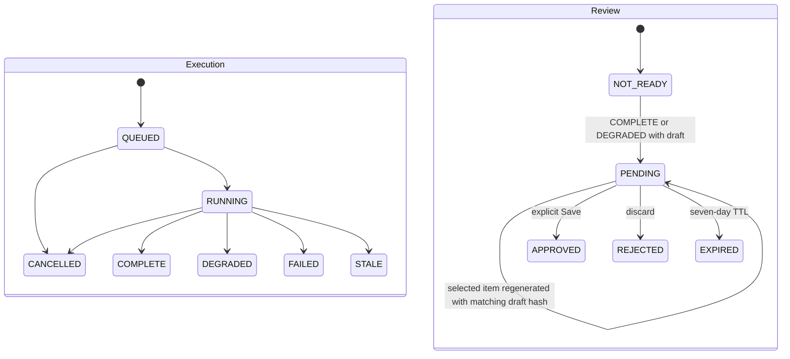

# Data Model: Tác tử tạo CV TalentPulse

## Ownership

- NestJS owns OnlineCV, candidate profile, canonical jobs, consent, queue operation, review status and persistence.
- FastAPI owns request validation, CV generation orchestration, grounding checks and the request-scoped Agent run.
- Agent Foundation owns only execution state, bounded decisions/tool dispatch and sanitized run observation.
- The browser owns unsaved editor changes until the user explicitly saves.

## Existing Entities and Reuse

### OnlineCV

Existing `online_cvs` row remains the durable CV entity. Its structured content columns/JSONB (`education`, `workExperience`, `projects`, `skills`, `activities`, `certificates`, `awards`, `sectionOrder`), `generationMode`, `contentVersion`, `sourceVersion`, `sourceProfileId` and `sourceProfileVersion` remain unchanged in meaning.

Existing JSONB fields are extended using validated subdocuments; no new table is required:

```text
revision.sourceTrace.generation
  existing operation identity, idempotency hash, owner, source/consent/version,
  template, locale, target job, queue status and safe error/warnings
  + implementation: "legacy" | "agent"
  + reviewStatus: PENDING | APPROVED | REJECTED | EXPIRED (optional)

generationSnapshot
  existing career-profile/localization retry data
  + pendingDraft: {
      operationId, draftHash, draft: CvDraft,
      sourceRefsByPath: target path -> source field/index references,
      fieldOriginsByPath: editable field path -> SOURCE | LOCALIZED | AI_SUGGESTED | FALLBACK,
      omissionsByPath: omitted field path -> safe reason code,
      sourceVersion, expectedContentVersion, consentVersion, consentPolicyHash,
      createdAt, expiresAt, reviewStatus: PENDING
    }
```

`pendingDraft` is only returned to its owner through the existing authenticated generation-status flow. It is removed when saved, rejected, superseded or expired after 7 days. An hourly cleanup in the existing NestJS scheduler clears expired payloads; expiration/rejection preserves operation identity/status metadata for idempotency and audit without retaining generated text.

Selected-item regeneration is an additive mode of the existing async generation operation. Its queued metadata contains only the pending review operation ID, expected pending `draftHash`, and a validated target path; it never contains draft text. `sourceRefsByPath` is internal JSONB metadata with source field/index references only (including multiple source indices for a grouped skill); it is not part of `CvDraft` or any public response. `fieldOriginsByPath` and `omissionsByPath` contain only allowlisted display paths and enum codes; they contain no source text, PII or provider messages and are exposed only in owner-checked review metadata outside `CvDraft`. The worker resolves exactly one selected scalar/entry through `sourceRefsByPath` and the owner-scoped authorized source snapshot. Completion compares the expected hash before replacing that target and recomputes the pending draft hash and field-origin metadata; an absent/ambiguous source mapping or stale/failed run leaves the entire pending draft unchanged.

### CvGenerationOperation

This remains the current inline generation metadata rather than a new entity/table. Stable fields already include `operationId`, `idempotencyKeyHash`, `status`, `kind`, `userId`, `cvId`, source/profile versions, consent version/policy hash, template, locale, optional target job, timestamps, attempt count, error code and warnings. Add only the selected `implementation`, separate `reviewStatus`/`draftHash` metadata, and optional selected-regeneration target metadata (pending review operation/hash and validated target path).

Queue payload continues to contain opaque IDs, versions, hashes and the validated target path only; it never includes CV/profile/job text or credentials. Worker rechecks entitlement, owner, consent policy, source/profile version, canonical job snapshot and expected content version before it calls FastAPI and again before it stages a full draft or replaces a selected pending-draft item.

### CvDraft

No new persistent CV schema is introduced. The agent returns the existing `CvDraft` after the validated generation tool completes. `generation_mode` remains `EDITOR_ONLY`; source indices, warnings, locale, template, operation attempt identity and source/content versions remain mandatory.

The internal Foundation `CvGenerationReceipt` is not a business entity and is not persisted with candidate data. It contains only operation attempt ID, source/content versions, receipt ID and a SHA-256 of canonical serialized `CvDraft` bytes. The draft itself is held in request-scoped tool-handler memory only until the AI response is returned.

## Review and Write Rules

1. Before generation, NestJS authenticates the actor, checks candidate role, ownership, AI consent/policy, plan eligibility, template, job access and source version.
2. The worker stores the selected implementation and queued operation metadata, then dispatches only IDs/version/hash queue fields.
3. On validated AI output, NestJS verifies operation ID, candidate ID, job ID, template, locale, source version, attempt ID, consent and expected content version.
4. Successful output is placed in `generationSnapshot.pendingDraft`; canonical CV content, content version, primary status and searchable status stay unchanged. A new editor-only placeholder remains non-primary and non-searchable until the user explicitly saves/selects it.
5. The editor loads the staged draft with `reviewStatus=PENDING`. It keeps modifications local and does not autosave while review is pending.
6. Explicit Save calls the existing update path with `expectedContentVersion` and matching `generationApproval.operationId/draftHash`; NestJS requires this proof while review is pending, validates owner/consent/CAS, applies editor data, increments content version once, clears pending content and records `APPROVED` plus draft hash. Autosave/ordinary PATCH without this proof is rejected while pending.
7. Reject calls the additive discard operation; NestJS checks owner and operation ID, clears only pending content and records `REJECTED`. A stale or concurrently changed source returns conflict without applying the draft.
8. The existing NestJS scheduler clears expired pending content after 7 days and records `EXPIRED`. A new generation operation cannot silently replace a pending review; the caller must save or discard it first.
9. Selected-item regeneration is the exception to starting a separate review: it requires the matching pending operation ID/hash and a valid target path, then compare-and-sets only that item in the same pending draft. All other draft fields and canonical CV data remain unchanged.
10. A partial result is staged as `DEGRADED` only when each retained field independently passes structure and factual validation. `omissionsByPath` records a safe reason code for each removed field. If the retained set cannot be validated, fail the operation and stage no draft.

## State Transitions

Execution status and human-review state are separate dimensions. Existing execution status values and `PROCESSING` API mapping stay intact.



`FAILED`, `CANCELLED` and `STALE` have no pending review draft. `DEGRADED` may enter `PENDING` only when the existing validator confirms a safe partial draft; otherwise it becomes `FAILED`.

## Consistency and Concurrency

- A completion update is conditional on current operation ID/status, source version and expected content version; an abandoned/cancelled/late worker cannot stage output.
- User save is a second conditional write and increments `contentVersion` once. A concurrent editor change results in `409 Conflict`; the staged output remains available for review/merge or discard and is not force-applied.
- An idempotency key is bound to the normalized request/source/job/template/locale and, for selected-item regeneration, the pending review operation/hash/target; same key/same input replays operation status, same key/different input conflicts.
- A retry after terminal generation failure uses a new operation attempt ID and idempotency key. There is no automatic full-pipeline retry or hidden legacy retry.

## Privacy and Retention

- Full candidate/job snapshots are assembled in NestJS and sent only to the existing internal CV endpoint under `cv_generate_scope`.
- Raw CV text, generated content, receipt payload, provider prompt/response, identity/contact fields, candidate/user/CV IDs and access token are prohibited from logs and Foundation checkpoint storage. Only operation/correlation IDs, bounded counts, durations, statuses and safe error codes are permitted.
- CV facts are sent only to a provider that contractually prohibits training use and provides zero retention, with terms approved by the privacy/security owner before routing. Unknown, unapproved or non-compliant terms block routing; the approved provider and its terms must be recorded as release evidence.
- Pending output is available only to the owning user and expires after 7 days if not saved or rejected.
- Delete/soft-delete of the owning CV removes its pending draft through the existing owner lifecycle.
